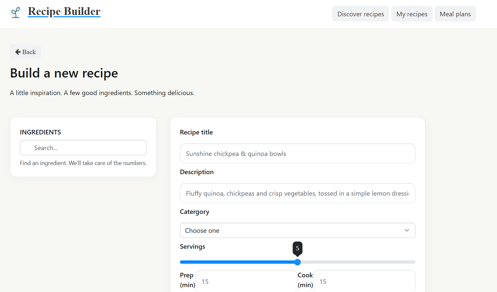
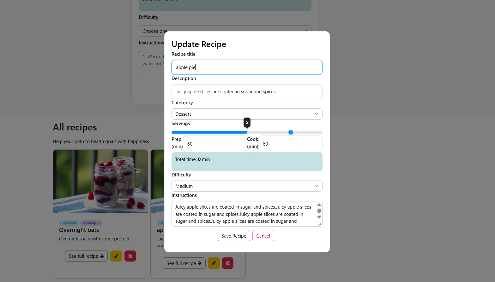

# Recipe Builder 🥗
A web app to create, browse, edit and delete recipes. Build a recipe with its category, servings, prep and cook times, difficulty and instructions, and see every recipe on the same page.




## Features
 
- **Create** recipes from a form on the home page
- **Browse** all recipes as cards, with category and servings badges
- **Edit** a recipe in a dialog that loads its current data from the database
- **Delete** a recipe with a confirmation prompt
- Total time (prep + cook) calculated live while filling the form
- Server-side validation with Mongoose (required fields, allowed categories and difficulties, minimum values)
- Responsive layout for desktop, tablet and mobile

## Tech stack
 
- **Backend:** Node.js, Express
- **Database:** MongoDB Atlas with Mongoose
- **Views:** EJS
- **Frontend:** Boostrap v6, HTML, CSS, vanilla JavaScript (`fetch` for edit and delete)

## Getting started
 
### Prerequisites
 
- Node.js 18 or later
- A MongoDB Atlas cluster (or a local MongoDB)
### Installation
 
```bash
git clone https://github.com/YOUR_USERNAME/recipe-builder.git
cd recipe-builder
npm install
```
 
### Environment variables
 
Create a `.env` file in the project root:
 
```
USER_DB=your_atlas_username
PASS_DB=your_atlas_password
SERVER_DB=your-cluster.xxxxx.mongodb.net
PORT=3000
```
 
The `.env` file is ignored by Git. Never commit credentials.
 
### Run
 
```bash
node server.js
```
 
Open http://localhost:3000

## Security
 
This app has **no authentication**: anyone with the URL can create, edit or delete recipes. That is fine for a local practice project or a demo, but it should be addressed before storing real data. Below is what is in place and what is recommended.


## What I learned
 
- Structuring an Express app with models, controllers and routes
- CRUD with Mongoose, including validation
- Rendering data with EJS and updating it with `fetch`
- Loading data into an edit dialog from the server
- Building a responsive layout with media queries

## Deployment

https://recipe-builder-lbok.onrender.com